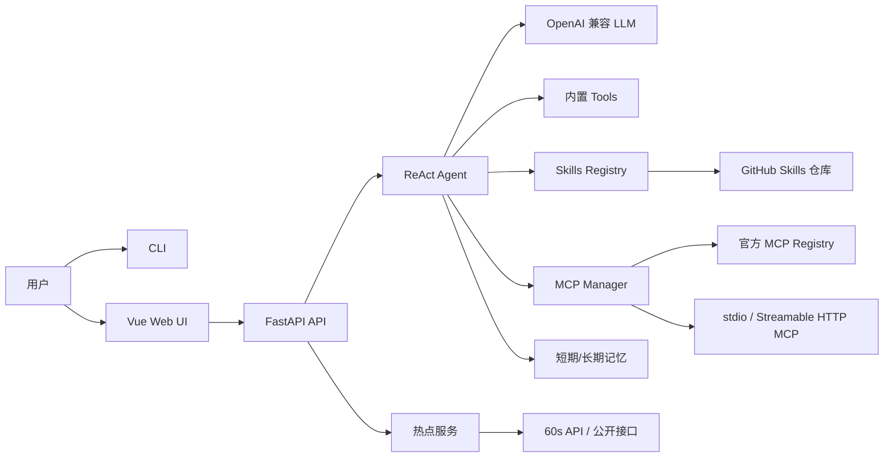
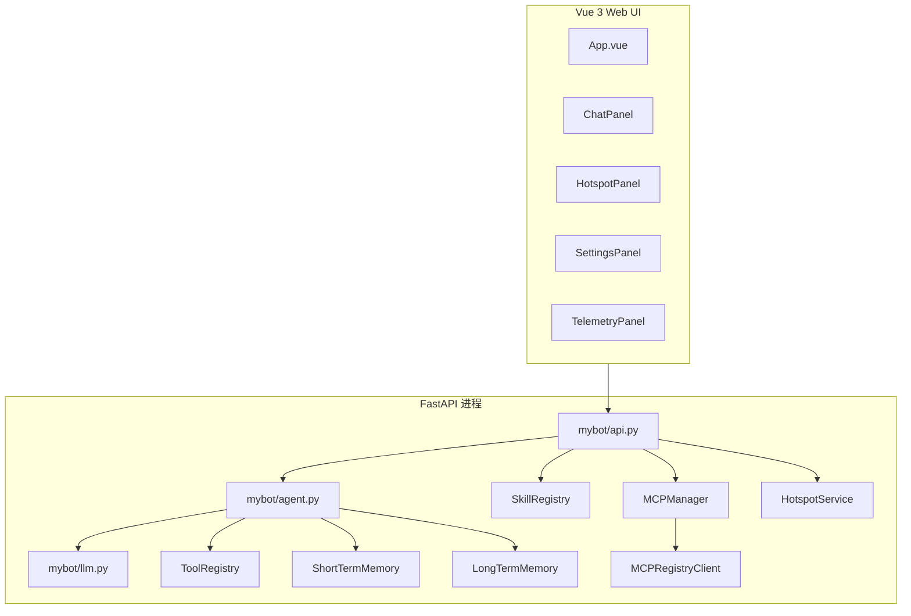
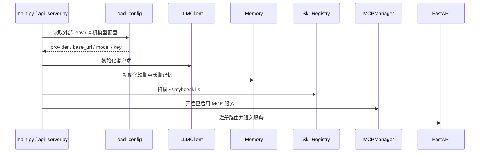
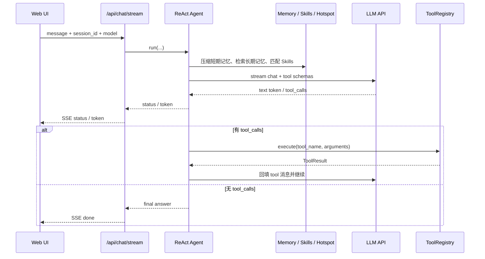
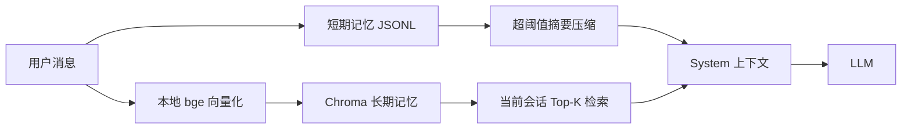
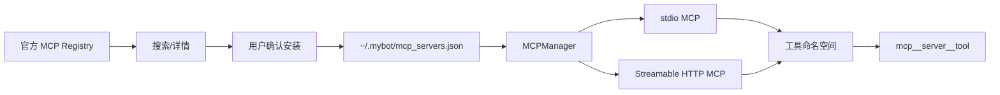
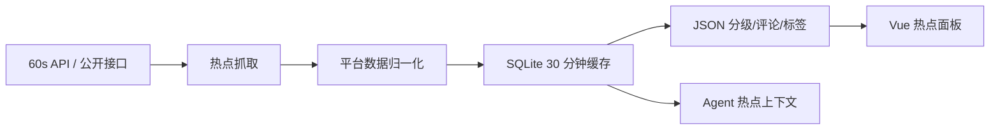

# MyBot 本地个人 Agent 助手软件规格说明书

| 项目 | 内容 |
| --- | --- |
| 文档编号 | MYBOT-SPEC-001 |
| 文档版本 | 1.0.1 |
| 文档状态 | 基线草案（Baseline Draft） |
| 编写日期 | 2026-11-15 |
| 适用代码基线 | 当前工作区快照 |
| 参考标准 | ISO/IEC/IEEE 29148、IEEE 1016、arc42 |
| 文档语言 | 中文 |

> 本文档描述当前代码库中已经存在或明确标记为部分实现的能力。未标记为“已实现”的内容不得作为已交付能力对外承诺。

## 1. 文档信息

### 1.1 目的

本文档定义 MyBot 本地个人 Agent 助手的产品范围、功能需求、非功能需求、系统架构、接口契约、数据设计、部署方式、安全边界、测试要求和需求追踪关系。

本文档用于：

- 作为开发、测试、部署和维护的统一技术基线。
- 作为需求验收和变更评审依据。
- 区分已实现能力、部分实现能力和未来规划。
- 为桌面应用打包、云端部署和后续多用户改造提供边界说明。

### 1.2 状态定义

| 状态 | 含义 |
| --- | --- |
| 已实现 | 当前代码中存在完整主链路，并有代码路径或测试支撑 |
| 部分实现 | 主链路存在，但存在明确限制、未覆盖路径或仅支持单实例 |
| 规划中 | 尚未在当前代码中实现 |
| 非目标 | 当前版本明确不承诺实现 |

### 1.3 修订记录

| 版本 | 日期 | 说明 |
| --- | --- | --- |
| 1.0.0 | 2026-11-15 | 基于当前工作区建立首版规格基线 |
| 1.0.1 | 2026-11-15 | 增加开发测试版与打包版数据共存策略 |

## 2. 引言

### 2.1 产品定位

MyBot 是一个运行在个人电脑或受控服务器上的 AI Agent 助手，提供 CLI 与 Web UI 两种入口。系统通过 OpenAI 兼容 Chat Completions 接口接入大模型，以 ReAct 循环调用本地工具、外部 MCP 服务和标准 Skills，并维护短期会话记忆与长期向量记忆。

### 2.2 目标用户

- 需要在本机执行文件、命令、网页和 PDF 任务的个人用户。
- 需要管理多个对话会话和长期偏好的个人用户。
- 希望配置自有模型 API Key 的桌面或本地 Web 用户。
- 需要扩展 Skills 与 MCP 工具的开发者和高级用户。

### 2.3 文档读者

- 产品与需求评审人员。
- 前后端开发人员。
- 测试与安全评审人员。
- 部署与运维人员。
- 后续桌面化和云端化开发者。

### 2.4 术语与缩写

| 术语 | 定义 |
| --- | --- |
| Agent | 基于 LLM 决策、调用工具并生成最终答复的执行体 |
| ReAct | Reason + Act 循环，模型在回答前可多轮调用工具 |
| Skill | 以 `SKILL.md` 为核心的标准流程知识目录 |
| MCP | Model Context Protocol，外部工具服务的标准连接协议 |
| SSE | Server-Sent Events，服务端向浏览器推送事件流 |
| JSONL | 每行一个 JSON 对象的持久化格式 |
| Chroma | 本地持久化向量数据库 |
| RAG | 检索增强生成；本项目用于长期记忆检索场景 |
| Registry | 官方 MCP 服务注册中心 `registry.modelcontextprotocol.io` |

### 2.5 约束与依赖

- 后端依赖 Python 3.10+。
- 前端开发依赖 Node.js 20.19+ 与 Vite 8。
- 向量模型默认使用 `models/bge-small-zh-v1.5`。
- 模型服务必须提供 OpenAI 兼容 Chat Completions 接口。
- Skills 下载依赖 GitHub 公共 API；MCP 搜索依赖官方 Registry API。
- 公网部署需要额外鉴权、用户隔离、反向代理和工具权限控制。

## 3. 系统概述

### 3.1 核心能力

- OpenAI 兼容模型接入与模型切换。
- 用户自有 API Key 的本机保存与脱敏展示。
- 多轮 ReAct 工具调用。
- 文件、Shell、网页、PDF 与记忆工具。
- 短期 JSONL 记忆与长期 Chroma 向量记忆。
- 多会话管理及会话记忆隔离。
- 抖音、B站、微博、小红书热点面板。
- LLM 热点分级、评论、标签与灵感推荐。
- 标准 Skills 的扫描、安装、启停和上下文注入。
- 官方 MCP Registry 搜索、多服务连接与工具命名空间。
- SSE 流式对话、复制回复、重新生成。
- Vue 3 Web UI 与低饱和浅色主题。

### 3.2 系统上下文



### 3.3 部署形态

| 形态 | 状态 | 说明 |
| --- | --- | --- |
| 本地 CLI | 已实现 | 通过 `python main.py` 启动 |
| 本地 Web | 已实现 | FastAPI 托管 `ui/dist`，默认 `127.0.0.1:8000` |
| 前后端分离 | 支持 | Vue 静态资源可部署到 EdgeOne Pages，后端部署到 CVM |
| 桌面应用 | 规划中 | 建议使用 pywebview/Tauri + 本地 FastAPI 打包 |
| 公网多用户 | 部分实现 | 缺少登录鉴权和用户级数据隔离，不能直接作为多租户服务 |

### 3.4 明确非目标

- 当前版本不提供强沙箱隔离。
- 当前版本不提供公网多用户登录、计费和租户管理。
- 当前版本不保证 Shell、文件写入和外部 MCP 的绝对安全。
- 当前版本不执行扫描件 PDF OCR。
- 当前版本不自动执行 Skill 脚本。
- 当前版本不提供分布式多副本一致性。
- 当前版本不承诺所有 MCP Registry 条目均可自动安装。

## 4. 功能需求

### 4.1 模型配置与切换

| 需求编号 | 需求描述 | 优先级 | 状态 |
| --- | --- | --- | --- |
| FR-LLM-001 | 系统应支持 OpenAI 兼容的 Base URL、模型名和 API Key 配置 | P0 | 已实现 |
| FR-LLM-002 | 设置弹窗应内置主流服务商和模型预设，由后端自动解析 Base URL | P0 | 已实现 |
| FR-LLM-003 | 用户应能填写自己的 API Key，并通过测试连接验证服务可用性 | P0 | 已实现 |
| FR-LLM-004 | API Key 应保存在仓库外的本机配置文件中，接口不得返回明文 | P0 | 已实现 |
| FR-LLM-005 | 对话输入框下方应支持当前服务商最多 3 个模型的快速切换 | P1 | 已实现 |
| FR-LLM-006 | 模型设置接口默认只允许本机来源访问 | P0 | 已实现 |

验收要求：

1. 选择服务商和模型后，界面展示自动匹配的 Base URL。
2. 输入 API Key 后可执行最小模型请求测试。
3. 保存后新对话立即使用新模型。
4. `GET /api/settings/llm` 不包含明文 API Key。
5. 选择非配置内模型时，后端返回 `400`。

### 4.2 对话与 Agent 执行

| 需求编号 | 需求描述 | 优先级 | 状态 |
| --- | --- | --- | --- |
| FR-CHAT-001 | 系统应提供非流式聊天接口 `/api/chat` | P0 | 已实现 |
| FR-CHAT-002 | 系统应提供 SSE 流式接口 `/api/chat/stream` | P0 | 已实现 |
| FR-CHAT-003 | Agent 应基于 ReAct 执行多轮工具调用，并受 `MAX_STEPS` 限制 | P0 | 已实现 |
| FR-CHAT-004 | 工具结果应回填到消息历史，允许模型继续推理 | P0 | 已实现 |
| FR-CHAT-005 | Web UI 应支持 Agent 回复复制和最新回复重新生成 | P1 | 已实现 |
| FR-CHAT-006 | 热点“讨论”应新建会话、切换视图、自动发送提示词并流式回答 | P1 | 已实现 |
| FR-CHAT-007 | 同一进程内的对话执行应通过运行时锁避免并发写入冲突 | P1 | 已实现 |

### 4.3 会话与记忆

| 需求编号 | 需求描述 | 优先级 | 状态 |
| --- | --- | --- | --- |
| FR-MEM-001 | 短期记忆应按会话保存到 JSONL 文件 | P0 | 已实现 |
| FR-MEM-002 | 消息超过阈值时应使用 LLM 摘要压缩，并保留最近消息窗口 | P0 | 已实现 |
| FR-MEM-003 | 摘要压缩切点应尽量对齐 user 消息，避免切断工具调用配对 | P0 | 已实现 |
| FR-MEM-004 | 长期记忆应使用 Chroma 与本地 `bge-small-zh-v1.5` | P0 | 已实现 |
| FR-MEM-005 | 长期记忆默认只能检索当前会话，跨会话检索需用户明确要求 | P0 | 已实现 |
| FR-MEM-006 | 系统应支持会话新建、切换、重命名、删除和历史查看 | P0 | 已实现 |
| FR-MEM-007 | 删除会话应同步删除短期记忆、长期记忆和索引记录 | P0 | 已实现 |
| FR-MEM-008 | 会话索引应保存 ID、标题、创建时间和更新时间 | P0 | 已实现 |

### 4.4 内置工具

| 需求编号 | 需求描述 | 优先级 | 状态 |
| --- | --- | --- | --- |
| FR-TOOL-001 | 系统应提供 `read_file`，读取文本文件并截断超长输出 | P0 | 已实现 |
| FR-TOOL-002 | 系统应提供 `write_file`，支持覆盖写入并自动创建父目录 | P0 | 已实现 |
| FR-TOOL-003 | 系统应提供 `run_shell`，支持超时和输出截断 | P0 | 已实现 |
| FR-TOOL-004 | 系统应提供 `web_search` 和 `web_fetch` | P1 | 已实现 |
| FR-TOOL-005 | 系统应提供 `pdf_parse`，提取正文和嵌套表格层级 | P1 | 已实现 |
| FR-TOOL-006 | 系统应提供 `memory_save` 与跨会话记忆检索工具 | P0 | 已实现 |
| FR-TOOL-007 | 工具异常应转换为错误结果回填给模型，不得使 Agent 循环崩溃 | P0 | 已实现 |

### 4.5 热点面板

| 需求编号 | 需求描述 | 优先级 | 状态 |
| --- | --- | --- | --- |
| FR-HOT-001 | 首页默认展示抖音、B站、小红书、微博四个平台 Tab | P1 | 已实现 |
| FR-HOT-002 | 每条热点应展示标题、AI 高/中/低分级、评论和标签 | P1 | 已实现 |
| FR-HOT-003 | 热点分析应由 LLM 严格输出 JSON，前端按 JSON 渲染 | P1 | 已实现 |
| FR-HOT-004 | 热点结果应缓存到 SQLite，默认有效期 30 分钟；过期时自动刷新，失败时回退旧快照 | P1 | 已实现 |
| FR-HOT-005 | B站和微博在 60s API 失败时应尝试公开接口兜底 | P1 | 已实现 |
| FR-HOT-006 | 小红书当前应固定显示“服务器正在维护”，不参与抓取和分析 | P1 | 部分实现 |
| FR-HOT-007 | 面板底部应展示基于热点生成的灵感推荐 | P1 | 已实现 |
| FR-HOT-008 | 对话涉及热点时应引用面板中的平台和标题，不得编造 | P1 | 已实现 |

### 4.6 Skills

| 需求编号 | 需求描述 | 优先级 | 状态 |
| --- | --- | --- | --- |
| FR-SK-001 | 系统应识别标准目录中的 `SKILL.md` 和 YAML frontmatter | P0 | 已实现 |
| FR-SK-002 | 系统应扫描本机 Skills 目录并写入 SQLite 索引 | P0 | 已实现 |
| FR-SK-003 | 系统应支持从 OpenAI/Anthropic GitHub 仓库浏览和下载 Skills | P1 | 已实现 |
| FR-SK-004 | 系统应支持 Skills 搜索、详情预览、启用、停用和删除 | P1 | 已实现 |
| FR-SK-005 | 对话时应根据问题匹配最多 2 个已启用 Skills 并注入上下文 | P0 | 已实现 |
| FR-SK-006 | Skills 上下文总量应受字符上限控制，避免挤占对话上下文 | P1 | 已实现 |
| FR-SK-007 | 系统不得因安装 Skill 而自动执行其中的脚本 | P0 | 已实现 |
| FR-SK-008 | 安装过程应限制文件数量、解压大小并拒绝路径穿越和符号链接 | P0 | 已实现 |

### 4.7 MCP

| 需求编号 | 需求描述 | 优先级 | 状态 |
| --- | --- | --- | --- |
| FR-MCP-001 | 系统应支持搜索和读取官方 MCP Registry 服务详情 | P0 | 已实现 |
| FR-MCP-002 | 系统应支持从 Registry 安装 stdio 包服务或 Streamable HTTP 远程服务 | P0 | 已实现 |
| FR-MCP-003 | 系统应支持同时管理多个 MCP 服务 | P0 | 已实现 |
| FR-MCP-004 | MCP 工具应以 `mcp__服务__工具` 命名空间注册 | P0 | 已实现 |
| FR-MCP-005 | 系统应支持 MCP 服务启用、停用、重启、删除和工具查询 | P0 | 已实现 |
| FR-MCP-006 | MCP 管理 API 不得返回明文环境变量和认证 Header | P0 | 已实现 |
| FR-MCP-007 | 单个 MCP 连接失败不得影响内置工具和其他 MCP 服务 | P0 | 已实现 |
| FR-MCP-008 | 系统应保留传统邮件 MCP 单槽位配置的兼容性 | P1 | 已实现 |
| FR-MCP-009 | 系统应支持 npm、PyPI、OCI 和远程 HTTP 常见安装路径 | P1 | 部分实现 |

### 4.8 Web UI 与 CLI

| 需求编号 | 需求描述 | 优先级 | 状态 |
| --- | --- | --- | --- |
| FR-UI-001 | Web UI 应提供热点首页、对话页、会话侧栏和运行状态面板 | P1 | 已实现 |
| FR-UI-002 | 设置弹窗应包含“模型 API”“Skills”“MCP”三个标签页 | P1 | 已实现 |
| FR-UI-003 | 对话消息应显示用户与 Agent 头像，并支持 Markdown 渲染 | P2 | 已实现 |
| FR-UI-004 | 页面应使用低饱和浅色主题并支持移动端布局 | P2 | 已实现 |
| FR-UI-005 | 前端生产构建应由 FastAPI 托管，开发模式应支持 Vite 代理 | P1 | 已实现 |
| FR-CLI-001 | CLI 应提供 REPL、斜杠命令、工具调用和会话切换 | P1 | 已实现 |

## 5. 非功能需求

### 5.1 安全需求

| 编号 | 需求 | 状态 |
| --- | --- | --- |
| NFR-SEC-001 | API Key 不得出现在前端构建产物、README、日志和 API 响应中 | 已实现 |
| NFR-SEC-002 | 用户配置的 API Key 应保存在仓库外，并尽量限制文件权限 | 已实现 |
| NFR-SEC-003 | 模型、Skills 和 MCP 管理接口默认只允许本机来源访问 | 已实现 |
| NFR-SEC-004 | MCP `env` 和 `headers` 在 API 响应中必须脱敏 | 已实现 |
| NFR-SEC-005 | Skills 和 MCP 内容应视为不可信外部输入 | 已实现 |
| NFR-SEC-006 | 公网部署前必须增加登录鉴权和用户级数据隔离 | 规划中 |
| NFR-SEC-007 | Shell、文件写入和高权限 MCP 应默认限制或关闭 | 部分实现 |
| NFR-SEC-008 | 系统应提供上传前安全扫描脚本 | 已实现 |

### 5.2 隐私需求

| 编号 | 需求 | 状态 |
| --- | --- | --- |
| NFR-PRV-001 | 会话、长期记忆和热点缓存应默认保存在本地 | 已实现 |
| NFR-PRV-002 | 用户应能够删除会话及其短期、长期记忆 | 已实现 |
| NFR-PRV-003 | 文件内容被模型工具读取后会发送到用户配置的 LLM 服务，界面和文档应明确提示 | 部分实现 |
| NFR-PRV-004 | 不得在文档和代码中写入真实密钥、手机号或个人 PDF | 已实现 |

### 5.3 可靠性需求

| 编号 | 需求 | 状态 |
| --- | --- | --- |
| NFR-REL-001 | 长期记忆初始化失败时，应用应降级启动 | 已实现 |
| NFR-REL-002 | 热点或 MCP 单个服务失败不得导致主进程退出 | 已实现 |
| NFR-REL-003 | 工具异常应转换为回填结果，不终止 ReAct 循环 | 已实现 |
| NFR-REL-004 | Agent 应设置最大执行步数，防止无限循环 | 已实现 |
| NFR-REL-005 | 当前版本应明确为单实例设计，不保证多副本 SQLite/Chroma 一致性 | 已实现 |
| NFR-REL-006 | 同一数据目录在同一时间只允许一个进程执行写入 | 规划中 |

### 5.4 性能需求

| 编号 | 需求 | 状态 |
| --- | --- | --- |
| NFR-PERF-001 | 对话应支持 SSE 增量输出，降低首字等待 | 已实现 |
| NFR-PERF-002 | 热点分析应使用缓存，避免每轮对话重复调用 LLM | 已实现 |
| NFR-PERF-003 | Skills 注入应限制匹配数量和字符总量 | 已实现 |
| NFR-PERF-004 | 工具输出应截断，避免超出模型上下文 | 已实现 |
| NFR-PERF-005 | 系统应支持热点和 Skills 目录短期缓存，减少外部 API 调用 | 已实现 |

### 5.5 兼容性与可移植性

| 编号 | 需求 | 状态 |
| --- | --- | --- |
| NFR-COMP-001 | Python 版本应不低于 3.10 | 已实现 |
| NFR-COMP-002 | 前端构建应使用 Vite 8，开发环境 Node.js 不低于 20.19 | 已实现 |
| NFR-COMP-003 | 模型接入应兼容 OpenAI Chat Completions 协议 | 已实现 |
| NFR-COMP-004 | 路径不得硬编码固定盘符；模型默认使用项目相对路径 | 已实现 |
| NFR-COMP-005 | Windows、macOS、Linux 应使用同一套 Python/FastAPI 逻辑 | 部分实现 |

### 5.6 可维护性与可观测性

| 编号 | 需求 | 状态 |
| --- | --- | --- |
| NFR-MAINT-001 | LLM、Agent、工具、记忆、Skills、MCP、API 应模块化分层 | 已实现 |
| NFR-MAINT-002 | 公共接口应使用类型标注和中文 docstring | 已实现 |
| NFR-OBS-001 | `/api/health` 应提供轻量健康检查 | 已实现 |
| NFR-OBS-002 | `/api/status` 应返回模型、记忆、工具、Skills 和 MCP 状态 | 已实现 |
| NFR-OBS-003 | MCP 子进程日志应落盘并避免刷屏 | 已实现 |
| NFR-OBS-004 | 应提供结构化指标、调用链 Trace 与集中日志 | 规划中 |

## 6. 系统架构

### 6.1 容器与组件



### 6.2 启动流程



降级规则：

- 模型配置失败：FastAPI 仍启动，状态为 `degraded`，用户可进入 API 设置页。
- 向量模型失败：长期记忆关闭，短期记忆继续运行。
- 热点失败：热点接口返回错误或降级数据。
- 单个 MCP 失败：仅该服务不可用，其他工具保持可用。

### 6.3 对话与 ReAct 流程



### 6.4 记忆架构



关键规则：

- 短期记忆只在回合开始时压缩。
- 摘要切点尽量对齐 `user` 消息。
- 长期记忆写入由模型调用 `memory_save` 决定。
- 长期记忆默认按 `session_id` 物理隔离。
- 跨会话检索必须由用户明确要求。

### 6.5 Skills 注入流程


Skills 只作为流程知识注入，不作为系统指令，也不自动获得工具执行权限。

### 6.6 MCP 管理流程



命名空间示例：

```text
mcp__filesystem__read_file
mcp__github__search_repositories
```

### 6.7 热点流程



## 7. 数据设计

### 7.1 默认目录

默认数据根目录：

```text
<项目根>/data
```

可通过 `MEMORY_DATA_DIR` 覆盖。当前部署环境可以不使用项目目录，但必须在文档和配置中明确。

推荐结构：

```text
<MEMORY_DATA_DIR>/
├── sessions/
│   ├── index.json
│   └── <session_id>.jsonl
├── chroma/
├── hotspots.sqlite3
└── skills.sqlite3
```

用户目录配置：

```text
~/.mybot/
├── .env
├── llm_config.json
├── mcp_servers.json
├── skills/
└── mcp/
    └── <server_id>.log
```

### 7.2 会话实体

```json
{
  "session_id": "20261115-120000-abc",
  "title": "项目分析",
  "created_at": "2026-11-15T12:00:00",
  "updated_at": "2026-11-15T12:10:00"
}
```

### 7.3 短期记忆

JSONL 每行保存：

- 可选摘要记录
- 用户消息
- Assistant 消息
- 工具调用消息
- Tool 结果消息

消息格式遵循 OpenAI Chat Completions。

### 7.4 长期记忆元数据

```json
{
  "session_id": "20261115-120000-abc",
  "timestamp": "2026-11-15T12:00:00",
  "type": "fact | preference | conclusion",
  "tags": "身份/项目"
}
```

### 7.5 Skills 索引

SQLite `skills.sqlite3` 保存：

- id
- name
- description
- version
- tags
- path
- source
- enabled
- installed_at
- updated_at

### 7.6 MCP 配置

`~/.mybot/mcp_servers.json` 保存服务配置。API 返回时必须脱敏 `env` 和 `headers`。

状态字段包括：

- enabled
- connected
- tool_names
- error
- transport
- registry_name
- version

### 7.7 数据生命周期

| 数据 | 创建 | 删除 |
| --- | --- | --- |
| 会话 JSONL | 新会话或首条消息 | 删除会话 |
| 会话索引 | 新建会话 | 删除对应会话 |
| 长期记忆 | `memory_save` | 删除会话 |
| 热点缓存 | 刷新热点 | 手动删除数据目录 |
| Skills | 安装/扫描 | 删除 Skill |
| MCP 配置 | 安装 MCP | 删除 MCP |
| API Key | 保存设置 | 用户手动删除配置文件 |

## 8. 接口规格

### 8.1 API 总表

| 方法 | 路径 | 作用 | 访问边界 |
| --- | --- | --- | --- |
| GET | `/api/health` | 健康检查 | 公开 |
| GET | `/api/status` | 运行状态、模型、记忆、Skills、MCP | 公开只读 |
| GET | `/api/settings/llm` | 读取脱敏模型配置与预设 | 本机 |
| POST | `/api/settings/llm/test` | 测试模型连接 | 本机 |
| PUT | `/api/settings/llm` | 保存服务商、模型与 API Key | 本机 |
| GET | `/api/sessions` | 会话列表 | API 可用 |
| POST | `/api/sessions` | 新建会话 | API 可用 |
| PATCH | `/api/sessions/{id}` | 重命名会话 | API 可用 |
| DELETE | `/api/sessions/{id}` | 删除会话及记忆 | API 可用 |
| GET | `/api/sessions/{id}/history` | 会话历史 | API 可用 |
| POST | `/api/chat` | 非流式聊天 | API 可用 |
| POST | `/api/chat/stream` | SSE 流式聊天 | API 可用 |
| GET | `/api/hotspots` | 读取热点；缓存过期时自动刷新 | API 可用 |
| POST | `/api/hotspots/refresh` | 强制刷新热点 | API 可用 |
| GET | `/api/skills` | 搜索已安装 Skills | 本机 |
| POST | `/api/skills/refresh` | 重新扫描 Skills | 本机 |
| GET | `/api/skills/catalog` | 浏览 GitHub Skills 目录 | 本机 |
| GET | `/api/skills/{id}` | 查看 Skill 详情 | 本机 |
| POST | `/api/skills/install` | 从 GitHub 安装 Skill | 本机 |
| POST | `/api/skills/{id}/enable` | 启用 Skill | 本机 |
| POST | `/api/skills/{id}/disable` | 停用 Skill | 本机 |
| DELETE | `/api/skills/{id}` | 删除 Skill | 本机 |
| GET | `/api/mcp/registry/search` | 搜索官方 MCP Registry | 本机 |
| GET | `/api/mcp/registry/detail` | 读取 MCP 服务详情 | 本机 |
| GET | `/api/mcp/servers` | 已安装 MCP 状态 | 本机 |
| POST | `/api/mcp/servers/install` | 安装并连接 MCP | 本机 |
| POST | `/api/mcp/servers/{id}/enable` | 启用 MCP | 本机 |
| POST | `/api/mcp/servers/{id}/disable` | 停用 MCP | 本机 |
| POST | `/api/mcp/servers/{id}/restart` | 重启 MCP | 本机 |
| GET | `/api/mcp/servers/{id}/tools` | 查看 MCP 工具 | 本机 |
| DELETE | `/api/mcp/servers/{id}` | 删除 MCP 配置 | 本机 |

### 8.2 聊天请求

```json
{
  "session_id": "20261115-120000-abc",
  "message": "读取 README.md 并总结项目架构",
  "model": "deepseek-chat"
}
```

约束：

- `message` 长度为 1 到 20,000 字符。
- `session_id` 可选；为空时使用当前默认会话。
- `model` 可选；必须属于当前模型选项。
- 记忆关闭时只允许默认会话。

### 8.3 SSE 事件

响应类型：

```text
Content-Type: text/event-stream
```

事件示例：

```text
data: {"type":"status","message":"正在思考…"}

data: {"type":"token","content":"你"}

data: {"type":"token","content":"好"}

data: {"type":"done","answer":"你好","session":{...},"session_id":"..."}
```

工具调用状态：

```json
{"type":"status","message":"正在调用工具：read_file"}
```

错误事件：

```json
{"type":"error","message":"Agent 运行失败：..."}
```

客户端约束：

- 必须按 `\n\n` 分帧。
- 只处理以 `data:` 开头的事件。
- `done` 后停止读取。
- 反向代理必须关闭缓冲并设置足够长的读取超时。

### 8.4 模型设置请求

```http
PUT /api/settings/llm
Content-Type: application/json
```

```json
{
  "provider_id": "deepseek",
  "model": "deepseek-chat",
  "api_key": "用户自己的 API Key"
}
```

响应不得包含 `api_key` 明文，只返回：

- `api_key_configured`
- `api_key_hint`
- `provider_id`
- `base_url`
- `model`
- `models`
- `applied`

### 8.5 Skills 安装请求

```json
{
  "repo": "openai/skills",
  "path": "skills/.curated/pdf",
  "ref": "main"
}
```

### 8.6 MCP 安装请求

```json
{
  "name": "ai.cloudbrowser/mcp",
  "version": "latest",
  "transport": "streamable-http",
  "package_index": 0,
  "remote_index": 0,
  "env": {},
  "headers": {},
  "tools": []
}
```

约束：

- `transport` 支持 `stdio` 与 `streamable-http`。
- `stdio` 需要 Registry 中存在 npm、PyPI 或 OCI 包。
- `tools` 为空表示暴露该服务全部工具。
- API 返回的 `env` 和 `headers` 必须脱敏。

### 8.7 错误语义

| HTTP 状态 | 语义 |
| --- | --- |
| 400 | 参数、模型、Skills 或 MCP 配置不合法 |
| 403 | 非本机访问受限设置接口 |
| 404 | 会话、Skill 或 MCP 服务不存在 |
| 409 | 记忆关闭时尝试创建会话，或资源冲突 |
| 500 | 服务端内部错误 |
| 502 | LLM、Registry、热点或外部服务连接失败 |
| 503 | 运行时、记忆、热点或 MCP 模块不可用 |

## 9. 工具与外部协议契约

### 9.1 内置工具

| 工具名 | 输入 | 输出 | 限制 |
| --- | --- | --- | --- |
| `read_file` | path | 文本内容 | 单次最多约 20,000 字符，无目录沙箱 |
| `write_file` | path, content | 写入结果 | 可覆盖文件，无目录沙箱 |
| `run_shell` | command, timeout | stdout/stderr/退出码 | 默认 60 秒，输出截断 |
| `web_search` | query | 搜索结果 | 依赖 Bing 页面结构 |
| `web_fetch` | url | 网页正文 | 不执行 JavaScript |
| `pdf_parse` | path, pages | 正文与表格 | 不支持扫描件 OCR |
| `memory_save` | content, type, tags | 写入结果 | 当前会话 |
| `memory_search_other_sessions` | query | 带来源的记忆 | 仅用户明确要求时使用 |

### 9.2 MCP 工具命名

```text
mcp__<safe_server_id>__<safe_tool_name>
```

要求：

- 工具名总长度不超过 64 字符。
- 非字母数字字符转换为下划线。
- 单个服务停用时注销其全部工具。

### 9.3 Skills 契约

```markdown
---
name: pdf-processing
description: 解析 PDF 文档并提取表格
version: 1.0.0
tags:
  - pdf
  - document
---

**PDF Processing**

工作流程说明……
```

要求：

- `SKILL.md` 必须存在。
- frontmatter 使用 YAML。
- 正文不得为空。
- 安装文件数量最多 500。
- 解压后总大小最多 50 MB。
- 拒绝符号链接和路径穿越。

## 10. 配置规格

### 10.1 配置读取优先级

```text
MYBOT_ENV_FILE
  > 项目根目录 .env
  > 用户目录 ~/.mybot/.env
  > 默认值
```

界面保存的服务商、模型和 API Key 优先于环境变量。

### 10.2 配置项

| 变量 | 默认值 | 说明 |
| --- | --- | --- |
| `OPENAI_API_KEY` | 无 | OpenAI 兼容 API Key |
| `OPENAI_BASE_URL` | `https://api.openai.com/v1` | 自定义环境的接口地址 |
| `OPENAI_MODEL` | `gpt-4o-mini` | 默认模型 |
| `OPENAI_MODEL_OPTIONS` | 空 | 自定义环境模型下拉项，最多 3 个 |
| `MYBOT_LLM_CONFIG` | `~/.mybot/llm_config.json` | 界面模型配置 |
| `MYBOT_ALLOW_REMOTE_LLM_SETTINGS` | `false` | 是否允许远程管理模型设置 |
| `MYBOT_SKILLS_DIR` | `~/.mybot/skills` | Skills 安装目录 |
| `GITHUB_TOKEN` | 空 | GitHub API Token，可选 |
| `MAX_STEPS` | `10` | ReAct 最大工具循环次数 |
| `TEMPERATURE` | `0.0` | LLM 采样温度 |
| `MEMORY_ENABLED` | `true` | 是否启用记忆 |
| `MEMORY_DATA_DIR` | `<项目根>/data` | 运行时数据根目录 |
| `MEMORY_MAX_MESSAGES` | `30` | 短期摘要压缩阈值 |
| `MEMORY_KEEP_RECENT` | `10` | 压缩后保留消息数 |
| `MEMORY_TOP_K` | `3` | 长期记忆检索数 |
| `MEMORY_SESSIONS_DIR` | `<data>/sessions` | 会话目录覆盖 |
| `MEMORY_CHROMA_DIR` | `<data>/chroma` | Chroma 目录覆盖 |
| `MEMORY_MODEL_DIR` | `<项目根>/models/bge-small-zh-v1.5` | 嵌入模型目录 |
| `MYBOT_MCP_CONFIG` | `~/.mybot/mcp_servers.json` | 多 MCP 配置 |
| `MCP_EMAIL_ENABLED` | `false` | 传统邮件 MCP 开关 |
| `MCP_EMAIL_COMMAND` | `uvx mcp-email-server@latest stdio` | 邮件 MCP 启动命令 |
| `MCP_EMAIL_TOOLS` | `send_email` | 邮件 MCP 工具白名单 |
| `MCP_EMAIL_ACCOUNT` | 空 | 邮件账号名 |
| `MCP_EMAIL_TIMEOUT` | `60` | 邮件 MCP 超时 |
| `HOTSPOT_ENABLED` | `true` | 热点面板开关 |
| `HOTSPOT_API_BASE` | `https://60s.viki.moe` | 热点 API 基础地址 |
| `HOTSPOT_CACHE_TTL_MINUTES` | `30` | 热点缓存有效期 |
| `HOTSPOT_MAX_ITEMS` | `8` | 每平台最大热点数 |
| `HOTSPOT_TIMEOUT` | `8` | 热点请求超时 |
| `API_HOST` | `127.0.0.1` | FastAPI 监听地址 |
| `API_PORT` | `8000` | FastAPI 端口 |
| `MYBOT_ENV_FILE` | 空 | 指定仓库外环境文件 |

## 11. 部署与运维

### 11.1 本地 Web 部署

```text
1. 创建 Python 虚拟环境
2. pip install -r requirements.txt
3. 配置外部 .env 或启动后通过 API 设置填写 Key
4. 安装/构建前端 ui/dist
5. python api_server.py
6. 访问 http://127.0.0.1:8000
```

要求：

- 真实 Key 不进入项目目录。
- `data/` 或 `MEMORY_DATA_DIR` 必须持久化。
- 不应将 FastAPI 直接暴露到不可信公网。

### 11.2 EdgeOne Pages + 腾讯云 CVM

```text
Vue 构建产物 → EdgeOne Pages
FastAPI + Chroma/SQLite → 腾讯云 CVM
Nginx → HTTPS、反向代理、SSE
```

要求：

- 前端构建时设置 `VITE_API_BASE_URL=https://api.example.com`。
- FastAPI CORS 只允许正式前端域名。
- Nginx 对 SSE 关闭 `proxy_buffering`，延长读取超时。
- 安全组仅开放 80/443，FastAPI 端口绑定本机。
- CORS 与 Nginx 分担不同职责，不重复设置响应头。
- 数据使用持久化磁盘并定期备份。

### 11.3 桌面应用方向

规划结构：

```text
pywebview / Tauri
  + 本地 FastAPI sidecar
  + ui/dist
  + 用户目录 data
  + 系统凭据存储
```

桌面化后，用户 Shell 和文件操作只作用于其本机，不需要在公网服务器上提供多用户 Shell。

### 11.4 运行检查

```powershell
Invoke-RestMethod http://127.0.0.1:8000/api/health
Invoke-RestMethod http://127.0.0.1:8000/api/status
```

理想状态：

```text
status = ok
startup_error = ""
```

### 11.5 开发测试版与打包版数据共存策略

#### 11.5.1 决策

当前开发测试版仅由项目所有者在本机使用，不对外分发；未来打包版也首先面向同一所有者。因此，不要求开发版和打包版使用两套完全隔离的用户数据。

允许打包版在所有者电脑上复用开发版的以下数据：

- API Key 和模型配置
- 会话历史
- 长期记忆
- Skills
- MCP 配置
- 热点缓存

其他用户首次安装打包版时，应使用自己的用户目录并创建全新数据，不继承开发者的数据。

#### 11.5.2 强制约束

1. 同一数据目录在同一时间只允许一个实例进行写入。
2. 开发测试版可继续使用 `127.0.0.1:8000`。
3. 打包版应使用随机空闲端口，避免与开发版抢占端口。
4. 所有者的打包版可以通过显式配置复用开发数据目录，但不得把开发路径写死为分发默认值。
5. 分发给其他用户时，默认数据目录必须由目标用户的系统用户目录推导。
6. 安装包不得包含 `data/`、`.env`、API Key、日志、Skills、MCP Token 或开发机会话。
7. 打包版不得意外继承开发环境的 `MEMORY_DATA_DIR` 等临时环境变量。
8. 模型目录属于只读资源，可以在多个实例间共享。
9. 数据目录应包含 `schema_version`；升级时执行迁移或提示用户备份。
10. 检测到同一数据目录已被其他进程占用时，应拒绝启动并给出明确提示。

#### 11.5.3 目标目录

所有者开发测试版示例：

```text
D:\MyBot-dev\
├── data\
├── llm_config.json
├── mcp_servers.json
├── skills\
└── logs\
```

打包版对其他用户的默认目录：

```text
Windows: %APPDATA%\MyBot\
macOS: ~/Library/Application Support/MyBot/
Linux: ~/.local/share/mybot/
```

所有者可在自己的电脑上通过本地配置将打包版指向开发数据目录，但该配置不得进入通用安装包默认值。

#### 11.5.4 实施状态

| 策略 | 状态 |
| --- | --- |
| 开发版与打包版允许复用所有者数据 | 已决策 |
| 打包版默认使用目标用户目录 | 规划中 |
| 打包版随机空闲端口 | 规划中 |
| 同一数据目录单实例写锁 | 规划中 |
| 数据 schema_version 与迁移 | 规划中 |
| 安装包排除开发数据与凭据 | 打包时必须执行 |
| 模型目录只读共享 | 已支持 |
| 其他用户首次安装使用空数据 | 设计目标 |

#### 11.5.5 验收标准

- 开发版运行时，打包版使用随机端口，不因 8000 端口冲突而失败。
- 两个实例指向同一数据目录时，第二个实例拒绝写入并提示实例冲突。
- 打包版在干净用户环境中首次启动时创建独立用户数据目录。
- 安装包和压缩包中不存在开发者的 `.env`、`data/`、Skill、MCP 配置或日志。
- 升级后旧数据可迁移或在使用前自动备份。
- 所有者显式指定开发数据目录后，可以复用已有会话和长期记忆。
## 12. 安全与威胁模型

### 12.1 关键资产

- 用户 API Key
- 会话和长期记忆
- 用户读取的文件内容
- Shell 执行权限
- MCP 环境变量和 Header Token
- Skills 下载内容
- 服务器配置和运行数据

### 12.2 信任边界

```text
用户浏览器
  │  不可信网络
  ▼
公网反向代理
  │
  ▼
FastAPI
  │
  ├── LLM 外部服务
  ├── Skills GitHub
  ├── MCP Registry
  └── MCP 外部服务
```

### 12.3 威胁与控制

| 威胁 | 风险 | 当前控制 | 残余风险 |
| --- | --- | --- | --- |
| API Key 泄露 | 高 | 仓库外配置、脱敏响应、安全扫描 | 本地文件仍为明文 |
| Prompt Injection | 高 | 系统提示、Skills 不作为系统指令 | 外部内容仍可能影响模型 |
| Shell 任意执行 | 高 | 默认个人本地使用、文档警告 | 无强沙箱 |
| 文件越权读取 | 高 | 工具错误处理 | 无允许目录白名单 |
| MCP 供应链风险 | 高 | 来源展示、安装确认、工具白名单 | 外部包可执行代码 |
| Skills 供应链风险 | 中 | 详情预览、路径校验、不自动执行脚本 | SKILL.md 仍可能包含恶意指令 |
| 跨用户数据访问 | 高 | 当前为个人单用户设计 | 公网多用户未隔离 |
| 数据库泄露 | 中 | `.gitignore`、本地数据目录 | 持久化盘需额外加密 |

### 12.4 安全强制要求

- 公网部署前必须实现登录鉴权。
- 多用户部署前必须实现 `user_id` 级会话和向量隔离。
- 公网环境默认关闭 `run_shell` 和任意路径写入。
- MCP 不得默认暴露全部高权限工具。
- Skills/MCP 内容不得被当作系统级指令。
- 备份和日志不得包含明文 API Key。

## 13. 可靠性与降级矩阵

| 故障 | 系统行为 |
| --- | --- |
| API Key 缺失 | FastAPI 启动，`/api/status` 显示 degraded，可通过设置页配置 |
| LLM 连接失败 | 返回错误；无自动切换模型的隐性行为 |
| 长期记忆模型缺失 | 长期记忆禁用，短期记忆继续 |
| Chroma 失败 | 记忆降级，工具和对话仍可运行 |
| 热点 API 失败 | 返回平台错误或缓存，B站/微博尝试兜底 |
| 热点缓存过期且刷新失败 | 返回旧快照并标记 stale 与 refresh_error |
| 小红书维护 | 返回 maintenance=true、items=[] |
| Skills 目录损坏 | 跳过无效 Skill，不影响应用启动 |
| Skills GitHub 失败 | 目录接口返回 502，本地 Skills 可用 |
| 单个 MCP 失败 | 该服务 tools 不注册，其他工具正常 |
| MCP HTTP 401 | 该服务状态记录错误，需用户补凭据 |
| MCP 进程超时 | 该服务关闭，不阻塞主进程 |

## 14. 测试与验收

### 14.1 构建与基础检查

```powershell
python -m compileall -q mybot
cd ui
npm run build
cd ..
python scripts\check_github_safety.py
```

当前环境若 PowerShell 找不到 `python`，可使用 `py -3` 或 Python 安装目录中的绝对路径。

### 14.2 验收场景

| 编号 | 场景 | 通过条件 |
| --- | --- | --- |
| AC-001 | 配置模型 API | 测试连接成功，保存后状态显示模型可用 |
| AC-002 | 模型切换 | 下拉菜单最多 3 个模型，非法模型返回 400 |
| AC-003 | SSE 对话 | 浏览器逐步显示 token，最后收到 done |
| AC-004 | 会话记忆 | 新建会话后历史独立，删除后记忆清除 |
| AC-005 | 长期记忆 | 写入后重启仍可检索，跨会话检索需明确要求 |
| AC-006 | 热点面板 | 抖音/B站/微博展示或降级，小红书显示维护 |
| AC-007 | 热点讨论 | 自动新建会话、切换视图、发送并流式回答 |
| AC-008 | Skills | 可扫描、搜索、启停、详情预览和 GitHub 安装 |
| AC-009 | Skills 注入 | 相关问题命中已启用 Skill，上下文受限 |
| AC-010 | MCP 搜索 | 官方 Registry 返回服务列表和详情 |
| AC-011 | MCP 安装 | stdio 或 Streamable HTTP 服务连接并注册命名空间工具 |
| AC-012 | MCP 凭据 | API 响应不含明文 env/headers |
| AC-013 | 安全检查 | 未发现密钥、手机号和非合成 PDF |

### 14.3 当前验证说明

当前仓库没有完整自动化测试套件。已执行的验证包括：

- Python 语法编译
- Vue 生产构建
- 本地 API Key 保存与脱敏集成测试
- Skills 扫描、安装、启停集成测试
- MCP stdio 演示服务连接与调用
- 公开 Streamable HTTP MCP 连接与工具发现
- 官方 Registry 搜索和安装测试
- GitHub 上传前安全检查

## 15. 需求追踪矩阵

| 需求组 | 主要实现 | 主要接口/测试 |
| --- | --- | --- |
| FR-LLM | `config.py`、`llm.py`、`llm_providers.py`、`llm_settings.py` | `/api/settings/llm` |
| FR-CHAT | `agent.py`、`api.py` | `/api/chat`、`/api/chat/stream` |
| FR-MEM | `memory.py`、`long_memory.py`、`sessions.py` | 会话 API、记忆工具 |
| FR-TOOL | `tools/` | ToolRegistry 与内置工具调用 |
| FR-HOT | `hotspots.py` | `/api/hotspots` |
| FR-SK | `skills.py` | `/api/skills`、SKILL.md 测试 |
| FR-MCP | `mcp_client.py`、`mcp_manager.py`、`mcp_registry.py` | `/api/mcp`、stdio/HTTP 测试 |
| FR-UI | `ui/src/` | `npm run build`、浏览器验收 |
| NFR-SEC | `llm_settings.py`、`mcp_manager.py`、`scripts/check_github_safety.py` | API 脱敏与安全检查 |

## 16. 已知限制

1. 没有强沙箱，Shell 和文件工具可直接访问进程有权限的资源。
2. 没有公网多用户登录和用户数据隔离。
3. Chroma 与 SQLite 为本地单实例存储，不适合直接多副本部署。
4. 热点依赖公共接口，可能限流或失败。
5. 小红书当前固定维护状态。
6. PDF 不支持扫描件 OCR。
7. Skills 目前只支持 OpenAI/Anthropic GitHub 目录搜索和手动 GitHub 安装。
8. Skills 脚本不会自动执行。
9. MCP 自动安装仅覆盖常见 npm、PyPI、OCI 和 Streamable HTTP。
10. MCP OAuth、签名校验和工具级权限模型尚未完成。
11. 缺少结构化 Metrics、Trace 和集中日志。
12. 桌面应用打包和系统 Keychain 集成尚未实现。
13. 当前没有统一自动化测试流水线和覆盖率报告。
14. 开发版与打包版共用一个数据目录时的单实例写锁尚未实现。
15. 打包版目标用户目录、数据版本迁移和安装包隔离尚未实现。

## 17. 风险与开放问题

| 编号 | 风险/问题 | 处理建议 |
| --- | --- | --- |
| RISK-001 | 公网暴露 Shell 工具 | 公网模式禁用或将执行迁入沙箱 |
| RISK-002 | 多用户共享同一数据目录 | 增加 user_id 和租户隔离 |
| RISK-003 | Skills/MCP 提示注入 | 增加内容扫描和权限确认 |
| RISK-004 | MCP 包版本漂移 | 固定版本、记录 digest/checksum |
| RISK-005 | 外部 API 限流 | GITHUB_TOKEN、Registry 缓存、重试策略 |
| RISK-006 | 本地密钥文件明文 | 接入 Windows Credential Manager / macOS Keychain |
| RISK-007 | 多实例数据分叉 | 外置数据库和向量库后再水平扩容 |
| RISK-008 | 前端与后端跨域配置错误 | 部署前执行 CORS 和 SSE 验收 |

## 18. 变更管理

- 新增或修改功能需求必须分配唯一需求编号。
- 每次发布必须更新文档修订记录。
- 实现状态变化必须同步更新追踪矩阵。
- 安全相关修改必须补充威胁模型和验收场景。
- 新增外部服务必须记录来源、版本、权限和失败降级行为。
- 任何真实密钥、个人文件和运行数据不得写入文档或提交到 Git。

## 19. 附录

### 19.1 状态说明

```text
已实现：主链路存在并已通过基础验证
部分实现：存在明确限制
规划中：尚未在当前代码中实现
非目标：当前版本不承诺
```

### 19.2 推荐的人工验收顺序

```text
1. 健康检查
2. 模型 API 设置与测试连接
3. SSE 对话
4. 会话和记忆
5. 内置工具
6. 热点面板
7. Skills 安装与注入
8. MCP 搜索、安装与工具注册
9. GitHub 安全检查
```

### 19.3 文档结束

本文档描述的是当前工作区的实现基线。任何超出本文档的实现或安全承诺，必须经过需求变更和验收流程。