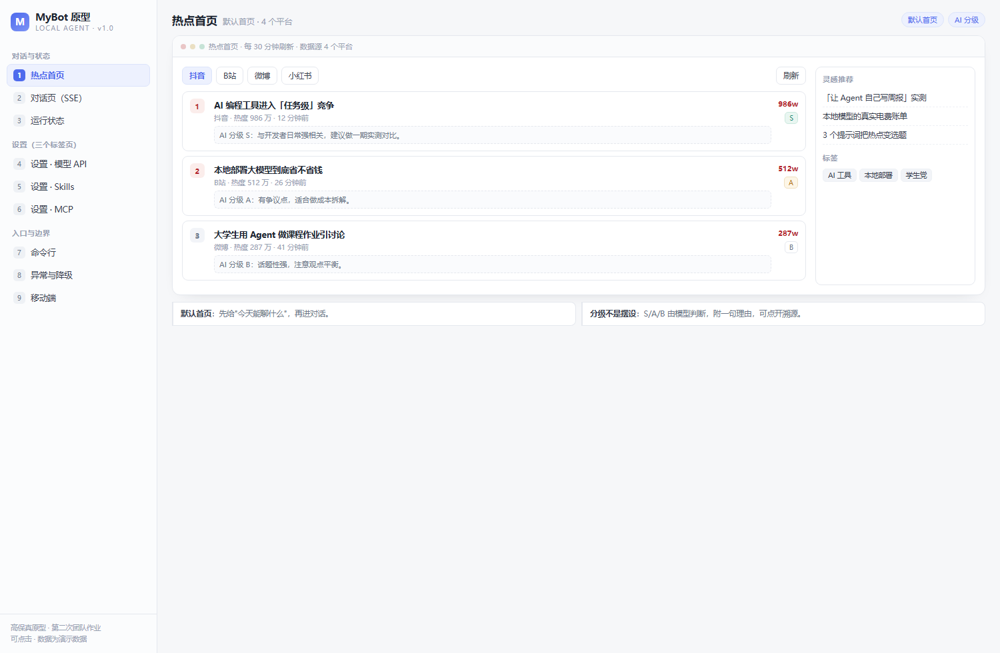
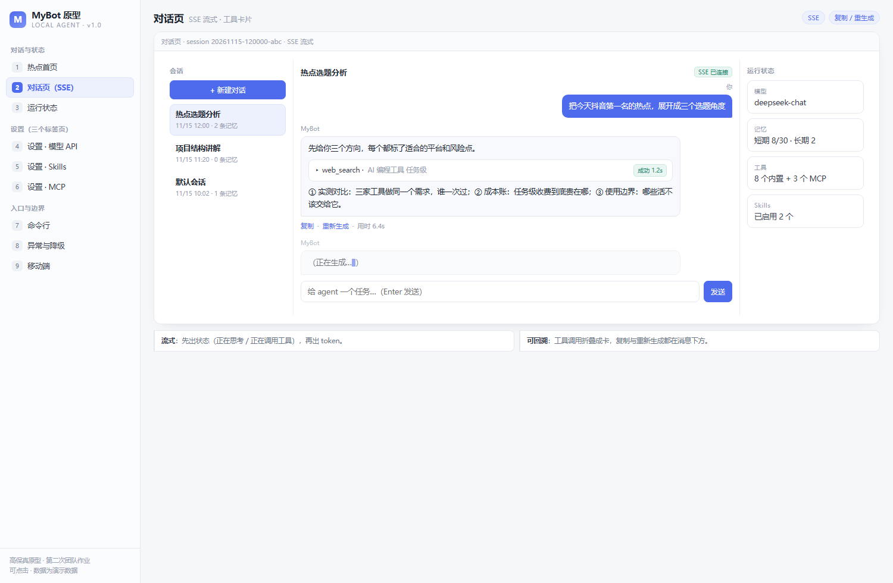
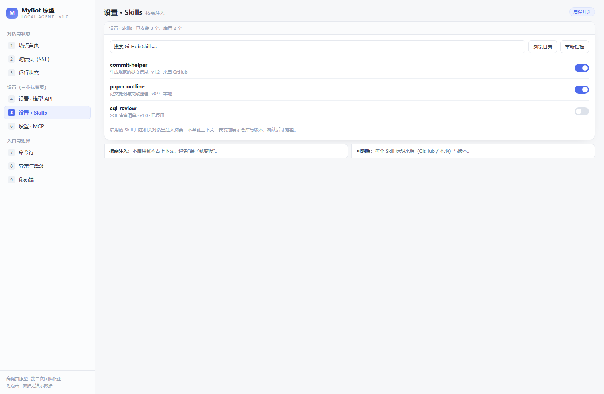
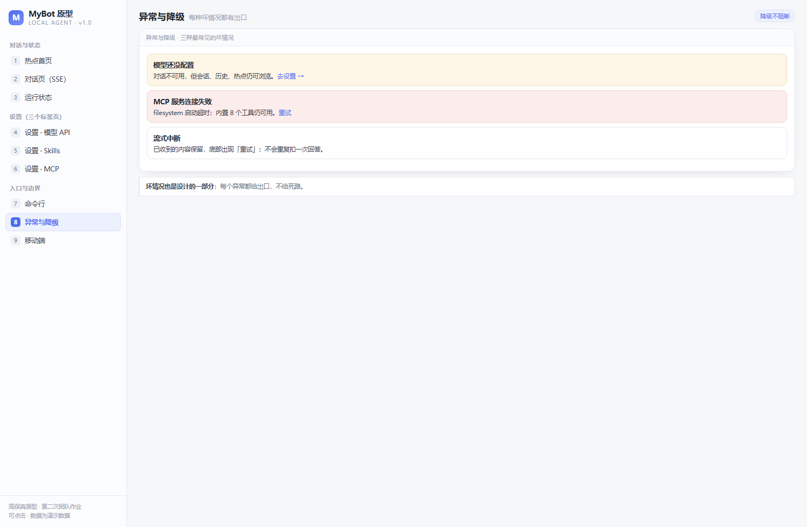
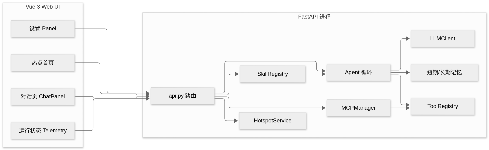
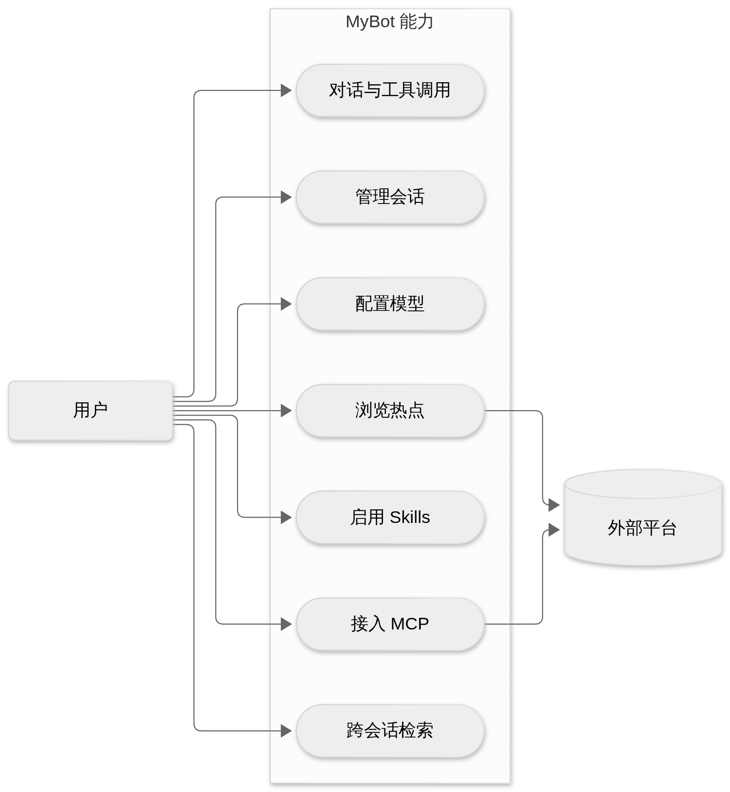
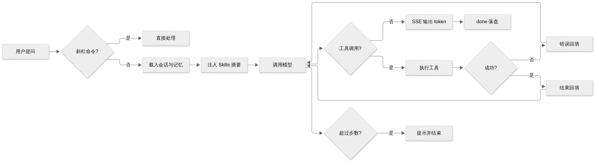
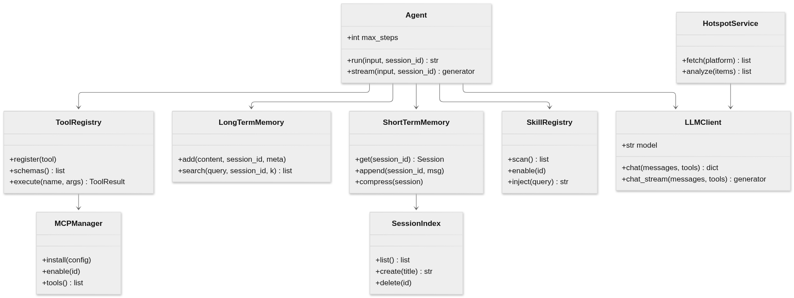
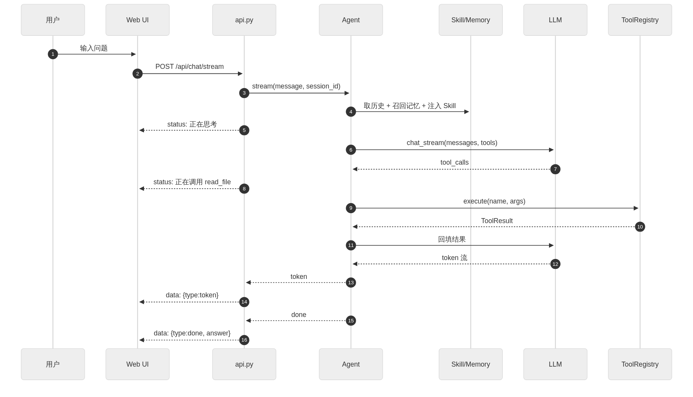
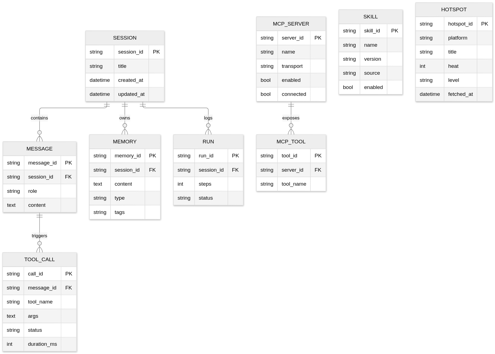

# MyBot 个人 Agent 助手——第二次团队作业：原型设计 + 概要设计

| 项目 | 内容 |
| --- | --- |
| 作业所属课程 | 软件工程 · 2024 级 Class56（[班级博客](https://edu.cnblogs.com/campus/gdgy/Class56-Grade2024-CS)） |
| 作业要求 | 【第二次团队作业——原型设计 + 概要设计（作业页链接）】 |
| 团队名称 | 【队名】 |
| 团队成员学号-名字 | 郑剀元、陈梓铤 |
| 项目名称 | MyBot（本地个人 Agent 助手） |
| 项目仓库 | https://github.com/Zztt417/----3/tree/main/5 |

**作业的目标（我们理解的作业目标，约 180 字）**

第一次作业把"做什么"写成了 59 条功能需求、34 条非功能需求；这一次要回答两个更硬的问题：**用户看到的界面长什么样、点下去发生什么**，以及**界面背后靠什么结构撑住**。原型要能点、要有空态和错误态，不能只有"正常路径"；概要设计要能说清几个模块、谁调谁、数据落在哪、为什么这么选。两份东西必须互相指认得出来——原型上每个状态都能在架构里找到负责它的模块，架构里每个模块都能在原型里找到用户看得见的那一面。做完这一步，编码阶段才不用边写边改结构。

---

## 一、原型设计

原型交付的是一套**可交互的高保真原型**，不是静态线框：浏览器打开就能点，切页面、切平台、展开工具卡片、开关 Skill 都是真的。这样做的代价是要写样式，好处是**交互规则被验证过一遍**——比如"模型没配置时对话不可用，但历史和热点照常能看"，在原型里是真的点得出来的。

- 在线预览：<http://127.0.0.1:4097/>（本机 `python -m http.server 4097`）
- 原型源码：`原型/index.html`（单文件，无外部依赖）
- 规模：**4 个模块、9 个页面**，对应仓库里 `ui/src` 的 5 个 Vue 组件

原型采用**低饱和浅色主题**，与实现版本保持一致：白底、细边框、一个主色（#4F6BED），状态只用三种语义色（成功/警示/危险）。原因是这个工具的默认使用场景是白天长时间看，深色反而累。

### 1.1 总览

| 模块 | 页面 | 关键交互与规则 |
| --- | --- | --- |
| 对话与状态 | 热点首页 | 4 个平台切换；AI 分级 S/A/B 附一句理由；缓存 30 分钟，可手动刷新 |
| | 对话页 | SSE 流式：先出状态、再出 token；工具调用折叠成卡片；复制 / 重新生成 |
| | 运行状态 | 模型、记忆、工具、Skills、MCP 五块常驻，降级状态直接写出 |
| 设置（三个标签页） | 模型 API | 服务商预设、Base URL、模型、Key；先"测试连接"再保存 |
| | Skills | 扫描、浏览 GitHub 目录、安装、启停；只注入与当前话题相关的 |
| | MCP | 搜索官方 Registry、安装/启停/重启；工具按"服务__工具"命名 |
| 入口与边界 | 命令行 | 6 条斜杠命令；与网页共用会话与记忆 |
| | 异常与降级 | 模型未配置、MCP 断开、流式中断，三种坏情况各自的出口 |
| | 移动端 | 360px 宽度：会话栏收进抽屉，输入框贴底 |

### 1.2 热点首页

首页不是对话，是**热点**。理由很实际：打开工具时人通常还没有具体任务，先给"今天能聊什么"比给一个空输入框更有用。四个平台（抖音 / B站 / 微博 / 小红书）做成一行标签，列表里每条热点带三样东西：热度、AI 分级、一句理由。

分级不是装饰：**S 级**才建议立刻做，**A 级**值得做但要找角度，**B 级**先观察。右侧"灵感推荐"把热点翻译成选题——这一步是模型做的，但只给三条，避免又变成一屏废话。

### 1.3 对话页

对话页有三条硬规则：

1. **先状态、后内容**。SSE 一上来先发 `status`（"正在思考…"），调用工具时再发 `status`（"正在调用 read_file"），然后才是一个个 `token`。用户能分清"在等"和"在动"。
2. **过程折叠**。每次工具调用一张卡，写清工具名、参数摘要、耗时、成功与否；默认收起，点开才看返回内容。
3. **可回溯**。每条回答下面有"复制""重新生成"，重新生成会复用同一轮上下文而不是重开一段。

会话侧栏常驻但很窄（220px）：会话是记忆的边界，切换会话等于换一套记忆，这件事必须一眼看见。

### 1.4 设置：三个标签页

设置做成弹窗里的三个标签页，而不是三页深链接，因为它们是"同一类操作"——都是**改变它下一步怎么干活**，但不该和聊天记录混在一起。

- **模型 API**：常见服务商给预设，选完只填 Base URL、模型、Key；Key 输入框只显示前后四位；保存前可以"测试连接"，避免存了才发现填错。
- **Skills**：列出已安装的 Skill（名称、版本、来源、启停开关）。启用的 Skill 只在**相关**对话里注入一段摘要，不常驻上下文——否则装十个 Skill，每次对话都变慢。
- **MCP**：搜索官方 Registry，装完显示连接状态与工具数；工具的完整名字是 `服务名__工具名`，避免两个服务都有 `search` 时打架。

### 1.5 异常与降级

三种坏情况，每种都给出口：

| 情况 | 界面表现 | 用户能做什么 |
| --- | --- | --- |
| 模型没配置 | 对话不可用，会话与热点仍可浏览 | 一键跳到设置 |
| MCP 连不上 | 该服务标红，内置 8 个工具照常 | 重试 / 停用 |
| 流式中断 | 已收到的内容保留 | 底部出现"重试"，不重复扣一次回答 |

写完这三条我们才发现：**异常态比正常态更能说明系统边界**。正常态谁都能画，异常态才暴露设计者有没有想过"出错之后怎么办"。

### 1.6 交互规则清单

| 编号 | 规则 | 原因 |
| --- | --- | --- |
| R1 | 发送后输入框不锁死，但发送按钮变为"停止" | 长回答要能中断 |
| R2 | 工具卡片默认收起 | 一屏日志没人看 |
| R3 | 会话切换前不弹确认 | 切换成本要低，数据本来就在 |
| R4 | 删除会话要二次确认并说明"记忆一并删除" | 这是不可逆操作 |
| R5 | 设置改动只在新一轮对话生效 | 正在跑的任务不能被中途换模型 |
| R6 | Skill 停用立即从注入列表移除 | 行为要可解释 |

### 1.7 四个突出特点

1. **先给内容再给输入框**：热点首页承担"不知道聊什么"的启动问题。
2. **过程可见但不刷屏**：SSE 状态 + 折叠的工具卡片，兼顾可解释与可读性。
3. **能力可插拔**：Skills 与 MCP 都在设置里，装/停/重启即时生效。
4. **坏情况有出口**：每个异常态都不是死路。

---

## 二、概要设计

### 2.1 架构：一个进程，两组组件

| 侧 | 组件 | 职责 |
| --- | --- | --- |
| 前台 | `App.vue`、`ChatPanel`、`HotspotPanel`、`SettingsPanel`、`TelemetryPanel` | 只做渲染、转发与状态提示，不做业务判断 |
| 后台 | `api.py`（31 个接口） | 路由、组装运行时、托管 `ui/dist` |
| | `agent.py` | ReAct 循环，最多 10 步 |
| | `llm.py` / `llm_providers.py` / `llm_settings.py` | 模型调用、服务商预设、配置读写 |
| | `tools/*` + `ToolRegistry` | 8 个内置工具，统一 schema 与错误兜底 |
| | `memory.py` / `long_memory.py` / `sessions.py` | 短期 JSONL、长期 Chroma、会话索引 |
| | `skills.py`（`SkillRegistry`） | 扫描、安装、启停、按相关性注入 |
| | `mcp_manager.py` / `mcp_registry.py` | MCP 服务生命周期、Registry 搜索、工具命名空间 |
| | `hotspots.py`（`HotspotService`） | 抓取、缓存、LLM 分级与灵感 |

**三条新增链路**是这一版的关键：

- **Skill 注入**：请求进来先算相关度，命中才把 Skill 摘要拼进系统提示，不命中就不占 token。
- **MCP 命名空间**：连接成功后把工具包装成 `server__tool` 注册进同一个注册表，Agent 侧无感知。
- **热点分析**：抓取与分级分离，抓取按平台缓存，分级只在缓存过期时跑一次。

### 2.2 UML 设计

| 图 | 用途 | 本文要点 |
| --- | --- | --- |
| 用例图 | 需求边界 | 1 个用户 + 2 类外部系统，7 个用例 |
| 活动图 | 业务流程 | 一次提问的判定：斜杠命令、是否调工具、成功/失败、步数上限 |
| 类图 | 系统结构 | 9 个核心类，体现 Agent 对记忆、Skills、工具的依赖 |
| 时序图 | 关键链路 | SSE 一轮 16 条编号消息，体现"先 status 后 token"的推送顺序 |
| ER 图 | 数据组织 | 7 个实体，把 Skill、MCP、热点也纳入模型 |

**用例图**：用户只发起 7 类动作（对话、会话、模型配置、热点、Skills、MCP、跨会话检索），外部平台只出现在热点抓取与 MCP 连接两处——**模型服务和外部平台都不是"用户"**，这一点画清楚，权限边界就不容易糊。

**活动图**里有四个判定。最容易漏的是"工具失败"这一支：失败不是终止，而是把错误当成结果回填，让模型自己修正——这条画出来，评审时才不会问"出错怎么办"。

**类图**九个类，依赖方向单一：`Agent` 依赖模型、工具、两层记忆与 `SkillRegistry`；`ToolRegistry` 再去接 `MCPManager`；`HotspotService` 只依赖 `LLMClient`。这样拆的好处是热点与 MCP 都能单独测——不需要启动完整对话。

**时序图**画的是 SSE 那条链路：16 条消息里，第 5、8 条是 `status`，第 14、16 条是 `token` 与 `done`。顺序不能换——先推 token 再推状态，前端就没法区分"正在调用工具"和"正在说话"。

### 2.3 数据设计

**七个实体**，前五个是会话域，后三个是"能力域"：

| 实体 | 说明 | 落地 |
| --- | --- | --- |
| SESSION | 一个会话 | `data/sessions/index.json` |
| MESSAGE | 一条消息 | `data/sessions/<id>.jsonl`，按行追加 |
| TOOL_CALL | 一次工具调用 | 随 MESSAGE 落在同一行（`tool_calls` 字段） |
| MEMORY | 一条长期记忆 | `data/chroma`，metadata 带 session_id |
| RUN | 一次运行 | 会话文件内的运行记录 |
| SKILL | 一个已安装技能 | `data/skills.sqlite3` |
| MCP_SERVER / MCP_TOOL | MCP 服务与工具 | `~/.mybot/mcp_servers.json` |
| HOTSPOT | 一条热点 | `data/hotspots.sqlite3`，带抓取时间 |

**为什么是混合存储，而不是一个数据库。** 三类数据形态差别太大：消息是追加写、按会话整份读，JSONL 最省事；记忆需要向量检索，只能用 Chroma；Skills 与热点是"带状态的列表"，要按条件查、要更新，用 SQLite 两分钟能写完。硬塞进一个库，要么给消息加索引（没用），要么给向量装插件（复杂）。

代价也写清楚：**跨域联查做不了**（比如"用过某 Skill 的会话里，哪些工具调用最慢"），只能各自查再在代码里拼。这个代价现在能接受，等真要做用量看板再考虑把 SESSION / MESSAGE / TOOL_CALL 迁进 SQLite。

### 2.4 五个关键取舍

| 取舍 | 选择 | 代价 | 为什么值 |
| --- | --- | --- | --- |
| 对话传输 | SSE 而不是 WebSocket | 只能服务端单向推 | 一问一答不需要双向，SSE 走普通 HTTP，代理友好 |
| Skill 加载 | 按相关度注入，不常驻 | 相关度算错就漏 | 装了十个 Skill 也不拖慢普通对话 |
| MCP 工具命名 | `服务__工具` | 名字变长 | 多服务并存不会撞名，模型也看得出归属 |
| 热点数据 | 平台级缓存 30 分钟 | 可能看到旧热点 | 抓取有反爬风险，缓存是最便宜的稳定手段 |
| 密钥存放 | 本机 `~/.mybot`，接口只回脱敏值 | 换机要重配 | 密钥不进仓库、不进前端，比"方便"重要 |

---

## 三、团队协作记录

### 3.1 开发计划与完成情况

| 阶段 | 主要工作 | 里程碑 | 产出 |
| --- | --- | --- | --- |
| 1 | 工程骨架、配置与启动 | M1 能跑 | CLI 可对话，`.env` 三级优先级 |
| 2 | 会话与两层记忆 | M2 记得住 | JSONL + 摘要压缩、Chroma 隔离检索 |
| 3 | 工具层 | M3 能动手 | 8 个内置工具、统一错误兜底 |
| 4 | Web UI 与 SSE | M4 双端可用 | 31 个接口、流式对话、复制/重生成 |
| 5 | 设置与模型切换 | M5 可换模型 | 服务商预设、测试连接、配置脱敏 |
| 6 | Skills 与 MCP | M6 可插拔 | 扫描/安装/启停、Registry 搜索、命名空间 |
| 7 | 热点面板 | M7 有入口 | 4 平台抓取、缓存、LLM 分级 |
| 8 | 原型与设计文档 | M8 设计定稿 | 9 页原型、五类 UML、ER 与规格书 |

### 3.2 分工安排

| 成员 | 角色 | 负责部分 | 本次作业贡献 |
| --- | --- | --- | --- |
| 郑剀元 | 内核与运行时 | Agent 循环、工具注册、记忆与会话、Skills / MCP 接入、接口层 | 架构图、类图、时序图；统筹与统稿 |
| 陈梓铤 | 前端与文档 | Web UI、SSE 渲染、设置与热点面板、原型、数据设计、文档校对 | 全部原型、用例图、活动图、ER 图；规格书与两份说明书互审 |

全队共同：文档互审、编号统一、提交与评审。

### 3.3 协作过程

**输入统一。** 以规格书为唯一事实来源：59 条功能需求（模型 6、对话 7、记忆 8、工具 7、热点 8、Skills 8、MCP 9、界面 5、CLI 1）、34 条非功能需求。原型每个页面要能指回某条 `FR-xxx`，架构每个模块要能指回某个页面。

**两条线并行。** 内核线先定接口（消息结构、SSE 事件类型、工具签名、Skill 注入点），前端线据此画原型与实现界面，文档线同步写数据设计与验收标准。各自负责，交叉评审：原型评审看"状态是否有出口"（空态、错误态、降级态），设计评审看"图能不能对上表"（类图字段与 ER 字段、接口与原型按钮）。

**两个卡点。** 一是 SSE 的兼容性——最初用普通 `fetch` 读流，遇到反向代理缓冲就卡住；改成 `ReadableStream` 逐帧解析 `\n\n`，并在 README 里写明"代理必须关闭缓冲"。二是 MCP 工具重名——两个服务都提供 `search` 时，模型会选错；改成 `服务__工具` 前缀后解决。

**提交与留痕。** 功能拆 Issue、改动走 PR、评审通过打 `LGTM`；文档与代码同仓库，改需求同步改文档。

---

## 四、原型与设计展示

- 原型在线预览：<http://127.0.0.1:4097/>（本机起服务即可点）
- 原型源码：`原型/index.html`
- 设计图：架构、用例、活动、类、时序、ER 共 6 张，均在上文对应小节内，可点开看大图
- 规格书：仓库 `docs/specs/mybot-spec-v1.0.md`（59 FR / 34 NFR / 31 接口）

---

## 五、交付物与链接

| 交付物 | 链接 |
| --- | --- |
| GitHub 团队仓库 | https://github.com/Zztt417/----3/tree/main/5 |
| 原型在线预览 | <http://127.0.0.1:4097/> |
| 原型源码 | `原型/index.html` |
| 软件规格说明书 | `docs/specs/mybot-spec-v1.0.md` |
| 系统设计说明书 | [MyBot_系统设计说明书.pdf](../docs/MyBot_系统设计说明书.pdf)（v1.0 基线） |
| 数据设计说明书 | [MyBot_数据设计说明书.pdf](../docs/MyBot_数据设计说明书.pdf)（v1.0 基线） |

> 说明：两份说明书的架构与数据章节对应本文第二节；这一版新增的 Skills、MCP、热点三块已写入规格书第 4、6、7 章，说明书按基线版归档。
