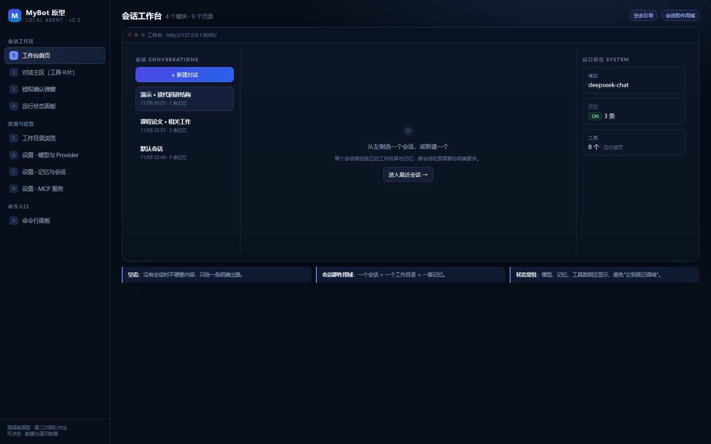
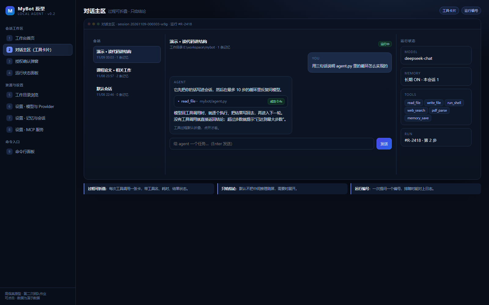
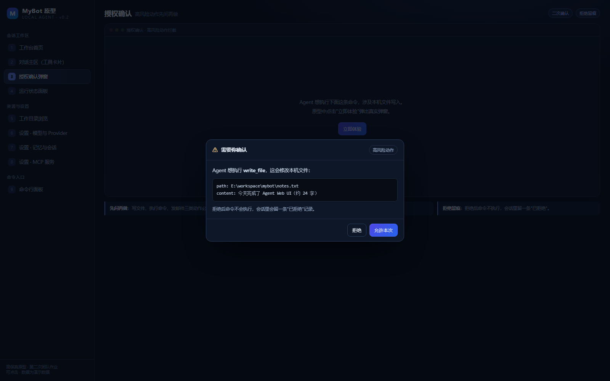
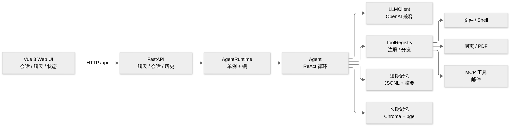
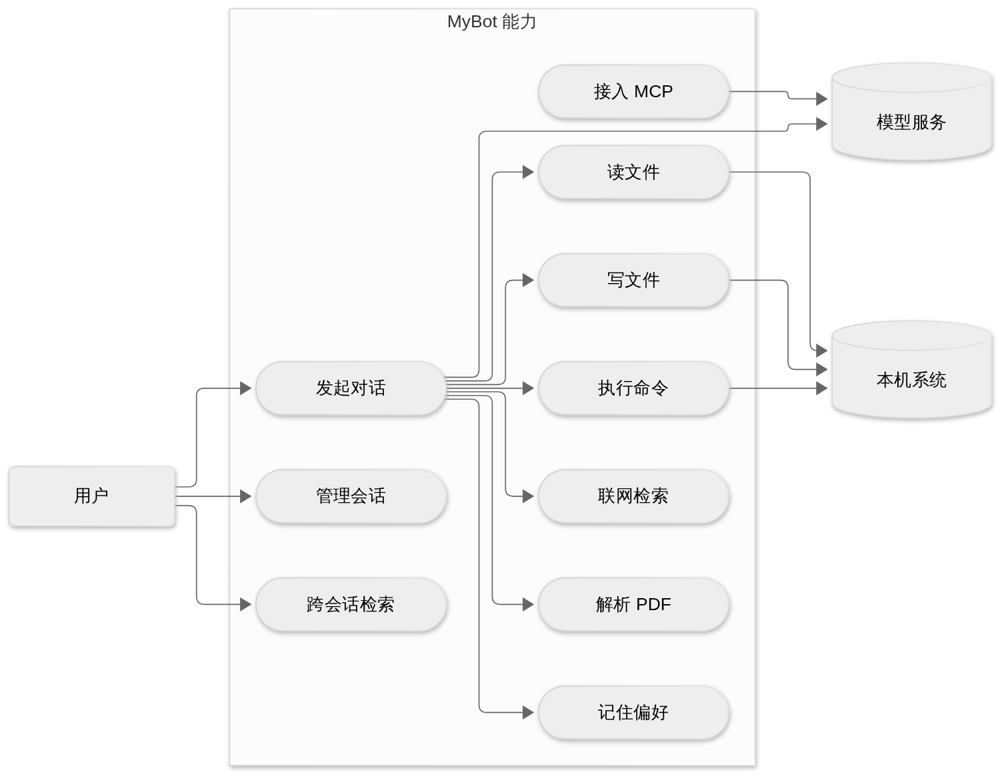
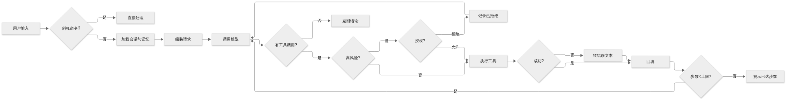
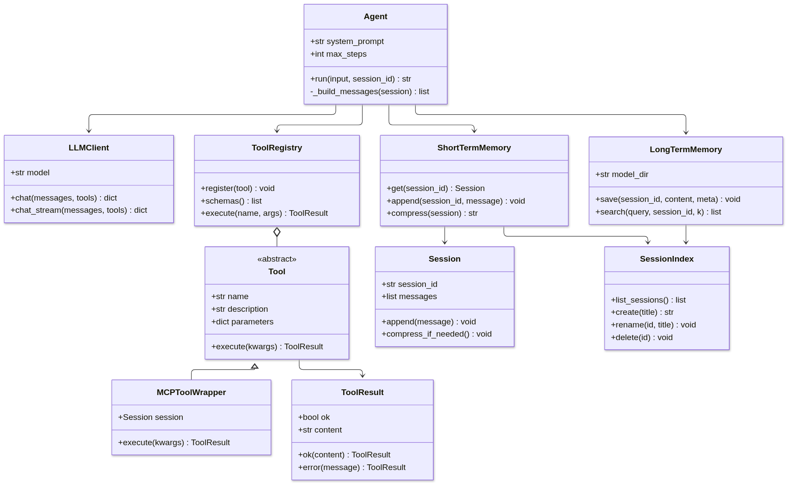
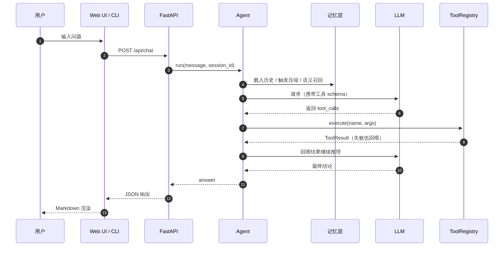
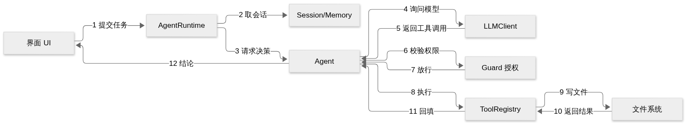
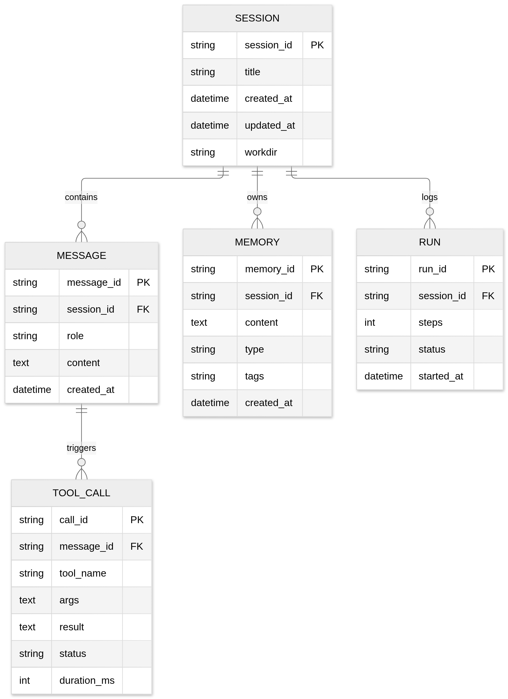

# MyBot 个人 Agent 助手——第二次团队作业：原型设计 + 概要设计

| 项目 | 内容 |
| --- | --- |
| 作业所属课程 | 软件工程 · 2024 级 Class56（[班级博客](https://edu.cnblogs.com/campus/gdgy/Class56-Grade2024-CS)） |
| 作业要求 | 【第二次团队作业——原型设计 + 概要设计（作业页链接）】 |
| 团队名称 | 【队名】 |
| 团队成员学号-名字 | 郑剀元、陈梓铤 |
| 项目名称 | MyBot（个人 Agent 助手） |
| 项目仓库 | https://github.com/Zztt417/----3/tree/main/第四次作业 |

**作业的目标（我们理解的作业目标，约 170 字）**

第一次作业解决了"做什么"，这一次要解决"长什么样、怎么搭"。原型把需求落成能点的界面：用户在哪儿点、点了之后发生什么、危险动作怎么拦；概要设计把界面背后的结构定下来：分几层、谁调谁、数据放哪、表怎么建。两份东西必须对得上——原型里的每个状态，都要能在架构里找到负责它的模块；架构里的每个模块，也要能在原型里找到用户看得见的那一面。做完这一步，编码阶段才不用边写边改结构。

---

## 一、原型设计

原型交付的是一套**可交互的高保真原型**，不是静态线框：浏览器打开就能点，切换页面、新建会话、展开工具卡片、触发授权弹窗都是真的。相比在原型工具里画静态页面，这样做的代价是要写样式，好处是**交互规则本身被验证过一遍**——比如"拒绝授权后命令不执行且留痕"，在原型里是真的点得出来的。

- 在线预览：<http://127.0.0.1:4096/>（本机运行，`python -m http.server 4096`）
- 原型源码：`原型/index.html`（单文件，无外部依赖，双击也能看）
- 规模：**4 个模块、9 个页面**，其中会话工作区 4 页、资源与设置 4 页、命令入口 1 页

### 1.1 总览

| 模块 | 页面 | 关键交互与规则 |
| --- | --- | --- |
| 会话工作区 | 工作台首页 | 空态不硬塞内容；新建会话；会话按最近使用排序 |
| | 对话主区 | Enter 发送；工具调用做成可折叠卡片；一次提问一个运行编号 |
| | 授权确认弹窗 | 写文件、执行命令、发邮件前必须确认；拒绝后不执行、留痕 |
| | 运行状态面板 | 模型、记忆、工具、会话四块常驻，降级状态直接写出来 |
| 资源与设置 | 工作目录浏览 | 目录树 + 只读预览；越界路径一律拒绝，不做"警告后放行" |
| | 设置 · 模型与 Provider | 换模型只改三处；密钥脱敏显示 |
| | 设置 · 记忆与会话 | 阈值、保留条数、top-k 可见；跨会话检索默认关 |
| | 设置 · MCP 服务 | 服务 18 个工具只开放 1 个；连不上只降级不阻断 |
| 命令入口 | 命令行面板 | 6 条斜杠命令；与网页共用同一套会话、工具与记忆 |

### 1.2 会话工作区

**工作台首页**：左边会话、中间空态、右边状态。空态只给一条出路（"从左侧选一个会话，或新建一个"），不摆一堆装饰；右侧固定显示模型、记忆条数、工具数——用户对"它现在能干什么、记得什么"应该一眼可见，而不是靠猜。

**对话主区**：用户消息靠右、助手结论靠左，工具调用收成一张卡片（`read_file · mybot/agent.py · 成功 0.4s`），点开才看返回内容。默认只给结论，是因为把中间推理全刷出来，长任务会变成一屏日志；而排障时需要细节，所以卡片保留展开能力，并配一个运行编号，能和日志对上。

**授权确认**：Agent 要写文件、执行命令或发邮件时，先把完整命令和目标路径摆出来，允许/拒绝二选一。原型里点"拒绝"，提示是"命令未执行，会话已留痕"——这一条是设计约束，不是文案：**拒绝必须可追溯**，否则事后说不清是模型没做还是用户没让做。

### 1.3 资源与设置

工作目录页把"会话即边界"画了出来：目录树只展示当前会话绑定的工作目录，预览是只读的，上传和写入分开。设置拆成三页而不是一页堆完——模型、记忆、MCP 是三类不同的东西，改错的影响面也不同：模型改错是回答变差，记忆改错是"记错事"，MCP 改错可能把邮件发出去。分开之后，每页只承担一种风险。

### 1.4 命令入口

命令行不是"简化版"：`/sessions`、`/new`、`/switch`、`/delete`、`/history`、`/help` 六条命令直接处理，不消耗模型调用；普通文本才进 Agent。网页与命令行共用同一个运行时，所以命令行里建的会话，网页上能接着聊。

### 1.5 为什么没有"后台管理"

这次原型只做了前台，没有做后台管理端，是产品定位决定的：MyBot 是单用户、跑在自己电脑上的工具，没有"管理员"这个角色。原来后台要承担的事，被拆成三块塞回前台——**运行状态面板**（相当于监控）、**设置页**（相当于配置后台）、**安全检查脚本**（相当于审计，上传前跑一次）。硬加一个后台，只会让单机工具多一个没人登录的入口；如果二期要支持多人共享一台机器，再补后台才有意义。

每个原型页面下方都带三条设计说明（空态、边界、降级），原型里的标注不是装饰，是给评审用的：评审时逐条对着问"这条在架构里谁负责"，答不上来的就打回重做。

### 1.6 四个突出特点

1. **会话即边界**：一个会话 = 一个工作目录 + 一套记忆，文件与命令能力被限制在目录内。
2. **过程可折叠**：每次工具调用一张卡，带工具名、耗时、结果状态与运行编号。
3. **危险动作先问**：写文件、执行命令、发邮件三类动作强制确认，拒绝留痕。
4. **两端同源**：CLI 与 Web 共用同一套 Agent，不存在"网页功能少一半"。

---

## 二、概要设计

### 2.1 架构：四层，自上而下依赖

| 层 | 组成 | 回答的问题 |
| --- | --- | --- |
| 接入层 | Web UI、CLI、HTTP `/api`、MCP 桥接 | 请求从哪进来 |
| 服务层 | FastAPI、AgentRuntime（进程内单例 + 锁） | 一次任务交给谁、并发怎么控 |
| 内核层 | Agent（ReAct 循环）、LLMClient、提示词装配、授权 Guard | 怎么决策、什么时候停下来问人 |
| 能力与运行时 | 工具注册表、文件/命令、网页/PDF、短期 + 长期记忆、Python 运行时 | 能做什么、靠什么撑住 |

**总约束**：换任何一层，不动其他三层。换模型只改 `LLMClient` 的配置；换界面只改接入层；加工具只往注册表里塞。这条约束是整个设计的地基。

### 2.2 UML 设计

| 图 | 用途 | 本文要点 |
| --- | --- | --- |
| 用例图 | 需求边界 | 3 类参与者（用户、本机系统、模型服务）、10 个用例，覆盖对话到跨会话检索 |
| 活动图 | 业务流程 | 一次对话的完整判定：斜杠命令、有无工具、是否高危、是否授权、步数是否用尽 |
| 类图 | 系统结构 | 9 个核心类，体现接口实现、组合与基数 |
| 时序图 | 关键链路 | 一轮对话 13 条带编号消息，体现"先写 assistant 再写 tool"的顺序约束 |
| 协作图 | 对象协作 | 6 个对象、12 条编号消息，展示界面—运行时—权限—工具—文件系统之间的交互 |

**用例图**把"用户能做什么"和"系统替用户动什么"分开：用户发起的只有对话、会话管理、跨会话检索；读文件、写文件、执行命令都是对话的下游动作，且都要经过本机系统；模型服务只负责决策，不直接碰文件。

**活动图**里有五个判定，其中三个是这次设计重点补的：**斜杠命令不消耗模型**、**高危动作要先授权**、**步数用尽要停**。第三个尤其重要——没有上限的循环，在模型反复调错工具时会变成死循环。

**类图**九个类，边界划得很硬：`Agent` 只做循环，`LLMClient` 只发请求，`ToolRegistry` 只分发，`Session` 只管消息，`LongTermMemory` 只管向量。这样做的好处是每个类都能单独测——工具层的测试不需要起模型，记忆层的测试不需要起 HTTP。

**时序图**画的是最容易踩坑的那条链路：`assistant(tool_calls)` 与 `tool(tool_call_id)` 必须成对且有序，一旦中间插入压缩或异常退出，接口直接报错。所以"压缩只在回合开始"不是优化，是正确性要求。

**协作图**以一次文件写入为例：界面提交任务 → 运行时取会话 → Agent 请求决策 → 模型返回工具调用 → Guard 校验 → 工具执行 → 结果回填 → 结论返回。12 条消息里，第 6、7 条（校验与放行）是这次新加的，对应原型里的授权弹窗。

### 2.3 数据设计

**五个实体**，以 SESSION 为枢纽：

| 实体 | 说明 | 关键字段 |
| --- | --- | --- |
| SESSION | 一个会话 | session_id（PK）、title、workdir、created_at、updated_at |
| MESSAGE | 一条消息 | message_id（PK）、session_id（FK）、role、content |
| TOOL_CALL | 一次工具调用 | call_id（PK）、message_id（FK）、tool_name、args、result、status、duration_ms |
| MEMORY | 一条长期记忆 | memory_id（PK）、session_id（FK）、content、type、tags |
| RUN | 一次运行 | run_id（PK）、session_id（FK）、steps、status、started_at |

**落地方式与取舍。** 这一版**没有引入关系数据库**，按数据形态分开存：

| 数据 | 落地 | 理由 |
| --- | --- | --- |
| 会话消息 | `data/sessions/<id>.jsonl` | 追加写、易回放、出问题能直接打开看 |
| 会话索引 | `data/sessions/index.json` | 列表与标题，量小 |
| 长期记忆 | Chroma 向量库 | 需要语义检索，文件做不到 |
| 向量模型 | `models/bge-small-zh-v1.5` | 本地推理，不出网 |

为什么不用关系库：单用户、单机、零部署是产品定位，SQLite 或 MySQL 都会把"装完就能用"变成"先建库"。代价也写清楚：**跨会话统计、复杂查询做不了**，只能靠代码遍历；如果二期要做用量看板，就把 MESSAGE / RUN 迁到 SQLite，ER 图已经按可以迁移的方式画好了。

**约束。** ①`session_id` 的外键语义由代码保证（文件存储没有外键），删除会话时级联清除该会话的 JSONL 与全部向量；②`TOOL_CALL` 必须挂在某条 MESSAGE 下，保证"一次调用有出处"；③API Key 不进任何数据文件，只存在仓库外的配置文件里。

### 2.4 三个关键取舍

| 取舍 | 选择 | 代价 | 为什么值 |
| --- | --- | --- | --- |
| 会话边界 | 一个会话绑一个工作目录 | 跨目录任务要换会话 | 越权风险从"靠模型自觉"变成"结构上做不到" |
| 授权位置 | 放在工具执行前（Guard） | 多一次交互 | 拦截点在执行前，模型无法绕过 |
| 过程展示 | 默认折叠，按需展开 | 新手不知道它做了什么 | 长任务可读；排障有卡片和运行编号兜底 |

---

## 三、团队协作记录

### 3.1 开发计划与完成情况

| 阶段 | 主要工作 | 里程碑 | 产出 |
| --- | --- | --- | --- |
| 1 | 仓库初始化、工程骨架 | M1 项目建立 | 初始目录、依赖清单、可启动的 CLI |
| 2 | 会话与记忆打通 | M2 会话可用 | JSONL 持久化、会话索引、摘要压缩 |
| 3 | 长期记忆接入 | M3 记忆可用 | Chroma + 本地向量模型、按会话过滤 |
| 4 | 工具层完成 | M4 能动手 | 文件、命令、联网、PDF 六个工具 |
| 5 | Web 界面 | M5 双端可用 | Vue 3 界面、`/api` 八个接口 |
| 6 | 原型定稿 | M6 交互定稿 | 4 模块 9 页、可点开的高保真原型 |
| 7 | 概要设计定稿 | M7 设计定稿 | 四层架构、五类 UML、ER 与数据落地 |
| 8 | 文档归档 | M8 提交 | 设计说明书、博客、答辩材料 |

### 3.2 分工安排

| 成员 | 角色 | 负责部分 | 本次作业贡献 |
| --- | --- | --- | --- |
| 郑剀元 | 内核与运行时 | Agent 循环、工具注册、记忆与会话、配置与降级；接口契约 | 架构分层、类图、时序图；统筹与统稿 |
| 陈梓铤 | 前端、测试与文档 | Web UI、原型与交互；验收用例、数据设计、文档校对 | 全部原型、用例图、活动图、ER 图；两份文档互审 |
| 全队 | — | 文档互审、编号统一、提交与评审 | 交叉评审记录 |

### 3.3 协作过程

**输入统一。** 以第一次作业的需求文档为唯一输入：功能需求 F1–F12、使用约束五条。原型里的每个页面必须能指回某条 F 编号，概要设计里的每个模块必须能指回某个页面——指不回去的，要么砍掉，要么补需求。

**两条线并行。** 内核线先定接口（工具签名、消息结构、会话 ID 传递方式），前端与文档线据此画原型、同步写数据设计。各自负责，交叉评审：原型评审看"状态是否有出口"（空态、错误态、拒绝态），设计评审看"图能不能对上表"（类图字段与 ER 字段是否一致）。

**提交与留痕。** 功能开发拆成 Issue，改动走 Pull Request，评审通过打 `LGTM` 再合并；文档与代码同仓库，改需求同步改文档，评审时看 diff 而不是看嘴。

**本次作业的两个卡点。** 一是"授权弹窗放哪一层"——放前端只能防误触，放工具里模型能绕过，最后定在 Guard，在工具执行前拦；二是"文件存储要不要上数据库"——权衡后维持文件 + 向量库，把迁移路径写进 ER 图，避免为了"看起来专业"增加部署成本。

---

## 四、原型与设计展示

- 原型在线预览：<http://127.0.0.1:4096/>（本机起服务即可点；无外部依赖）
- 原型源码：`原型/index.html`
- 概要设计图：架构图、用例图、活动图、类图、时序图、协作图、ER 图，共 7 张，均在上文对应小节内，可点开看大图

---

## 五、交付物与链接

| 交付物 | 链接 |
| --- | --- |
| GitHub 团队仓库 | https://github.com/Zztt417/----3 |
| 原型在线预览 | <http://127.0.0.1:4096/> |
| 原型源码 | `原型/index.html` |
| 系统设计说明书 | [MyBot_系统设计说明书.pdf](../docs/MyBot_系统设计说明书.pdf)（架构、UML、模块与接口，11 页） |
| 数据设计说明书 | [MyBot_数据设计说明书.pdf](../docs/MyBot_数据设计说明书.pdf)（ER、字段、落地与迁移，10 页） |

> 说明：原型与设计图均为本次作业产出，仓库内 `原型/` 与 `博客/images/` 可直接复现；两份说明书已归档在 `docs/`，与本文第二、三节同源；改设计时两处一起改。
